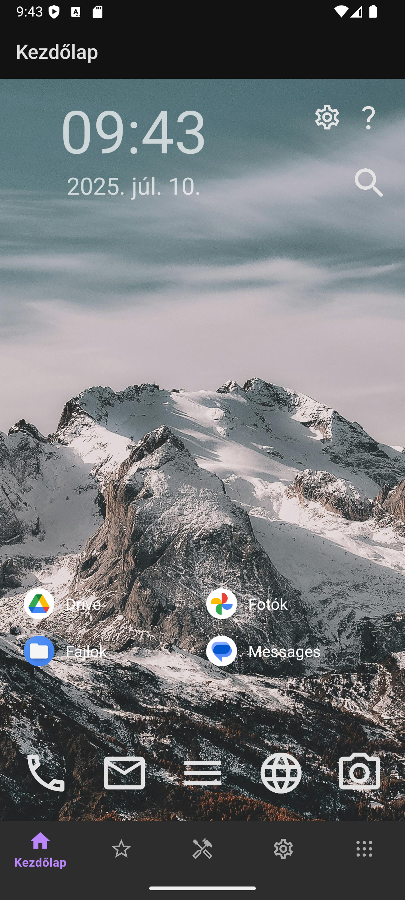
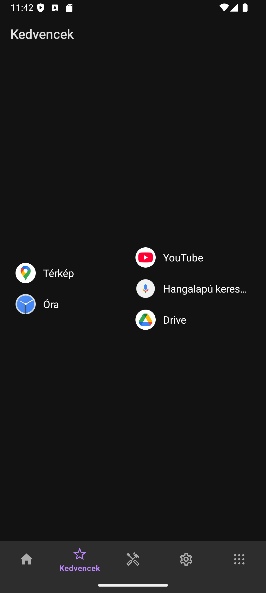

# TxTLauncher - Android launcher

Indító app - nekem
Minimalista, gyors.

Amire nekem szükségem van.
(HUN/ENG)

- választott app-ok a kezdőképernyőre
- kedvenc app-ok
- jegyzet
- indítóikonok android funkciókhoz
- háttérkép

  
# TxTLauncher
  

  <kbd>   </kbd>
    
  <kbd>   </kbd>
    
  <kbd>   </kbd>
    

  
  
# TxTLauncher_alt
  

  <kbd>   </kbd>
    
  <kbd>   </kbd>
    

  
  
# TxTLauncher-2
  

  <kbd>   </kbd>
    

  
  
# AppList
  

App-ok listája.
    

  
  
# LockDevice
  

Azonnal zárolja a készüléket. Tedd ki az asztalra az ikonját és indítsd el amikor szükséges.
    

